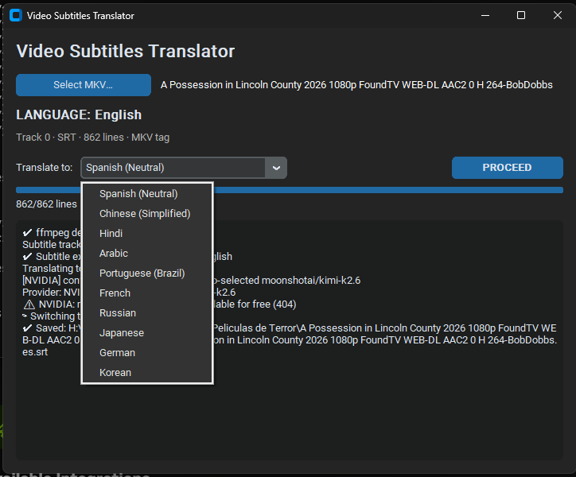

<div align="center">

# 🎬 Video Subtitles Translator

**Turn any MKV into a multilingual movie — in one click, for free.**

Extracts the subtitles from your MKV, detects the language, and produces a natural, *adapted* translation into the 10 most-spoken languages in the world using free LLM APIs — while keeping every timestamp, tag and style intact.




</div>

---

## ✨ Why this tool

Most subtitle translators either cost money per minute or produce stiff, word-for-word output that breaks the timing file. This one doesn't.

| | |
|---|---|
| 🆓 **100% free** | Runs on the free tiers of NVIDIA NIM and Ollama Cloud. When one runs out of quota, it switches to the other automatically. |
| 🎭 **Adapted, not literal** | Idioms, jokes, slang and swearing are localized like a professional subtitler would — *"raining cats and dogs"* → *"lloviendo a cántaros"*. |
| 🛡️ **Format-safe by design** | The LLM never sees timestamps or styling. Only dialogue text is sent; everything else is protected in code and restored byte-for-byte. |
| 🖱️ **One button** | Pick the MKV → language is detected automatically → choose a target → **PROCEED**. Done. |
| 📂 **Lands where you need it** | The translated file is saved right next to your MKV (`Movie.es.srt`), so any player picks it up instantly. |
| 🎨 **Keeps ASS/SSA styles** | Styled anime/fansub subtitles keep their fonts, positions and `{\...}` override tags. |

## 🌍 Supported languages

English · Spanish (neutral Latin American) · Chinese (Simplified) · Hindi · Arabic · Portuguese (Brazil) · French · Russian · Japanese · German · Korean

The source language is detected automatically and removed from the list, so you always get **exactly 10 targets**.

## 🚀 Quick start

```bash
git clone <your-repo-url> video-subtitles
cd video-subtitles
cp .env.example .env      # add your free API keys
./start.sh                # macOS / Linux
```

On **Windows**, just double-click `start.bat`.

The launcher handles everything: it checks Python 3.9+, Tkinter and **ffmpeg** (and offers to install it via winget / brew / apt / dnf / pacman), creates a virtual environment, installs dependencies and opens the app.

### 🔑 Free API keys
| Provider | Get a key | Role |
|---|---|---|
| NVIDIA NIM | [build.nvidia.com](https://build.nvidia.com) | Primary |
| Ollama Cloud | [ollama.com/settings/keys](https://ollama.com/settings/keys) | Automatic fallback |

You only need one of them; using both gives you more free volume.

## 🧠 How it works

```
MKV ──ffprobe──► pick first plain English text track (skip SDH / forced)
    ──ffmpeg───► extract SRT / ASS
    ──detect───► MKV language tag, or text-based detection
    ──parse────► protect indexes, timestamps, styles, {\tags}
    ──LLM──────► numbered JSON batches + rolling context  (NVIDIA ⇢ Ollama)
    ──validate─► every id returned? else retry / split batch
    ──rebuild──► Movie.<lang>.srt / .ass next to the MKV
```

**Resilience built in:**
- Model preference lists with **auto-discovery**: if a configured model doesn't exist, the best one in your live catalog is picked.
- Models outside the free plan are skipped automatically.
- Rate limits are retried with backoff; exhausted quotas trigger an instant provider switch.
- Uses the OS certificate store, so it works behind antivirus or corporate HTTPS inspection.

## ⚙️ Configuration (`.env`)

```ini
PROVIDER_ORDER=nvidia,ollama
NVIDIA_MODELS=deepseek-ai/deepseek-v3.2,qwen/qwen3-235b-a22b,meta/llama-3.3-70b-instruct
OLLAMA_MODELS=gpt-oss:120b,gemma4:31b,nemotron-3-super,gpt-oss:20b
BATCH_SIZE=30
```

The translation style lives in plain-text prompts you can tune:
- `prompts/system.md`: localization rules (tone, length, names, formatting)
- `prompts/user.md`: batch request format

## 📁 Project structure

```
├── app.py              # CustomTkinter GUI
├── core/
│   ├── media.py        # ffmpeg / ffprobe: probe, pick track, extract
│   ├── subformat.py    # SRT & ASS parsing with tag protection
│   ├── translator.py   # providers, fallback, batching, validation
│   └── languages.py    # top-11 languages + detection
├── prompts/            # editable LLM prompts
├── start.sh            # macOS / Linux launcher
└── start.bat           # Windows launcher
```

## 🗺️ Roadmap

- [ ] OCR for image subtitles (PGS / VobSub)
- [ ] Batch mode: translate a whole folder of movies
- [ ] Mux the translated track back into the MKV
- [ ] Translate into several languages in a single run

## 🤝 Contributing

Issues and pull requests are welcome, especially prompt improvements for specific languages.

---

<div align="center">
Built by <a href="https://albertocardenas.com">Alberto Cardenas</a>
</div>
